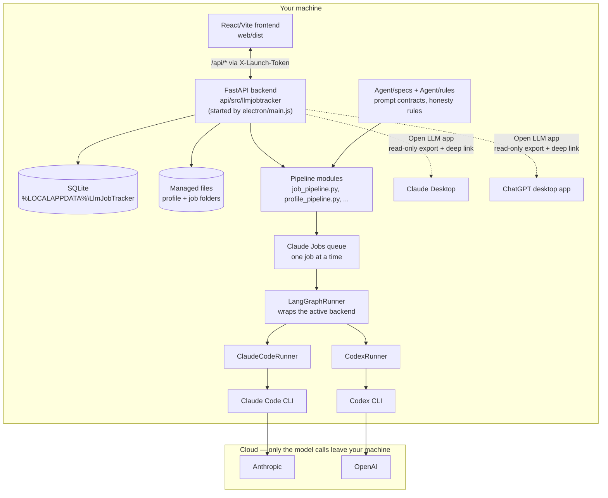

<p align="center">
  
</p>

# LlmJobTracker

## Overview

LlmJobTracker is a local, single-user desktop app for a job search. It takes in job listings and produces what an application needs: a tracker row, a listing file, a positioning analysis, a tailored CV, a cover letter, and the record of status changes — automating the manual, file-by-file workflow it replaces.

Every generated document is reviewed and approved by you before it is saved as final, sent, or changed in the tracker. Generated content uses only what your own career history, questionnaire analysis and strategy documents say; nothing is invented or embellished.

The app runs on your machine: the backend binds to 127.0.0.1, data lives in a local SQLite database under `%LOCALAPPDATA%\LlmJobTracker\`, and every generation step runs through a headless LLM CLI (Claude Code or Codex) behind a swappable `Runner` interface. The only traffic that leaves your machine is that CLI's own call to its provider.

Status: Phase 15 (Packaging and installers) in progress. Phases 0 through 14 are done — the tracker, profile onboarding, job intake, multi-LLM support, lanes, the dashboard, Open Applications, additional profile files and the Electron shell all run end to end against real data.

## Key features

- **Track job applications** — a tracker table (Company, Title, Lane, Location, Status, Last updated, Fit %, LLM queue badge) with full status history, inline editing, file previews, and a configurable column/view system, alongside a lighter Open Applications table for talent pools and cold outreach.
- **LLM analysis of your profile** — upload your CVs, cover letters and questionnaire once; an LLM turns them into a reviewed career history, questionnaire analysis and positioning strategy that every later document is grounded in.
- **LLM-assisted job-posting creation** — give it raw text, a URL, a saved HTML page or a PDF; the app extracts the text for you to review first, then an LLM turns the reviewed text into a clean, structured listing document.
- **Listing analysis, tailored CV and cover letter** — an LLM scores each requirement against your career history (the Fit % itself is computed in code from those scores, never guessed by the model), then writes a tailored CV and cover letter from your master CV and cover letter template as a set of tracked, reviewable edits.
- **Dashboard with lane analysis** — slicer-driven charts, a calendar heatmap, and per-lane strengths/weaknesses, with Active/Cold application tracking measured against a date you control.

## System requirements

LlmJobTracker runs on Windows or macOS. It has no built-in API key and no hosted backend — every LLM call goes out through a command-line tool you install and sign in to yourself (D-19, D-34, D-39).

### Required

- **Python 3.12+** and **[uv](https://docs.astral.sh/uv/)** — run the FastAPI backend. A packaged build bundles these; for development, install `uv` per its own docs.
- **Node.js 18+** — builds the React/Vite frontend. Development only; a packaged build needs nothing.
- **One LLM CLI, signed in to a paid plan.** Settings has one switch that picks which CLI the app's `Runner` interface calls (D-195) — you only need the one you plan to use:
  - **[Claude Code CLI](https://code.claude.com/docs/en/setup)** — on Windows, the native installer is `irm https://claude.ai/install.ps1 | iex` in PowerShell (or `npm install -g @anthropic-ai/claude-code` if you'd rather use npm). Needs a Claude Pro, Max, Team or Enterprise plan — the free claude.ai plan doesn't include Claude Code. Verify with `claude --version`.
  - **[Codex CLI](https://developers.openai.com/codex/quickstart?setup=cli)** — install via OpenAI's native installer (see the quickstart for the current command) or `npm install -g @openai/codex`. Needs a ChatGPT Plus/Pro/Team/Enterprise plan, or an API key. Verify with `codex --version`.

### Optional — for "Open LLM app"

The Job Applications and Profile pages can hand a read-only export of your data to a desktop LLM app with one click (D-210). This only works for whichever desktop app matches your selected CLI above, and only if it's installed:

- **[Claude Desktop](https://claude.com/download)** — opens the export via a `claude://` deep link, for the Claude Code backend.
- **[ChatGPT desktop app](https://chatgpt.com/codex)** (on Windows, installed via the Microsoft Store) — opens the export via a `codex://` deep link, for the Codex backend.

## Architecture

Electron (`electron/main.js`) owns the window and starts the FastAPI backend, which serves the built frontend and answers `/api/*` behind a per-launch token (D-43). The backend holds SQLite storage and a one-job-at-a-time Claude Jobs queue; each job's prompt is built from `Agent/specs/` and `Agent/rules/` and sent through whichever CLI backend is selected in Settings (D-195, D-205). The only traffic that leaves your machine is that CLI's own call to its provider (D-39); the desktop apps on the right are an optional, separate integration (D-210), not part of this request path.



## Key files

| Path | What it is |
|---|---|
| [CLAUDE.md](CLAUDE.md) | Rules and working style for anyone (human or Claude) building this app |
| [DEVELOPMENT-PLAN.md](DEVELOPMENT-PLAN.md) | Phases, the current phase, and each phase's approved step list |
| [DECISIONS.md](DECISIONS.md) | Every product and architecture decision, with its date and reason |
| [api/src/llmjobtracker/app.py](api/src/llmjobtracker/app.py) | The FastAPI app: routes, the per-launch token, startup |
| [api/src/llmjobtracker/runner.py](api/src/llmjobtracker/runner.py) | The `Runner` interface every LLM backend implements (D-19, D-20) |
| [api/src/llmjobtracker/claude_job_queue.py](api/src/llmjobtracker/claude_job_queue.py) | The one-job-at-a-time Claude Jobs queue |
| [api/src/llmjobtracker/*_pipeline.py](api/src/llmjobtracker/) | Prompt building and answer parsing for each LLM step (profile, job, lanes, pricing, Open Applications) |
| [api/src/llmjobtracker/migrations.py](api/src/llmjobtracker/migrations.py) | The SQLite schema, as an ordered list of migrations |
| [web/src/pages/](web/src/pages/) | One file per screen: Job Applications, Dashboard, Profile, LLM history, Settings |
| [web/src/components/app/](web/src/components/app/) | The app's own feature components — overlays, file preview, run traces |
| [web/src/lib/api.ts](web/src/lib/api.ts) | The frontend's one entry point into the backend API |
| [Agent/specs/](Agent/specs/) | The step contract and output schema for every LLM step |
| [Agent/rules/](Agent/rules/) | Default writing and honesty rules for generated documents, overridden by the user's own uploaded copies |
| [electron/main.js](electron/main.js) | The packaged app's entry point: starts the backend, serves the frontend, owns the window |
| [scripts/dev.py](scripts/dev.py) | Starts both servers for development with one shared launch token |
| [scripts/check.py](scripts/check.py) | The one command that runs every lint, type and test check |
| [planning/](planning/) | Stitch mockups and build notes — not committed, kept local only |

## Running in development

Prerequisites: Python 3.12 with `uv`, and Node.js.

Start the app with one command from the repo root:

```powershell
.\run.ps1
```

If PowerShell blocks the script, use `powershell -ExecutionPolicy Bypass -File .\run.ps1`. The script installs missing dependencies, starts the API on 127.0.0.1:8765 and the web app on http://127.0.0.1:5173/, and opens the browser. Press Ctrl+C in that window to stop both.

Under the hood, `scripts/dev.py` starts both servers with one launch token. The browser never sees the token: the dev server adds it to each `/api` request.

To run with the synthetic jobs, use `-Seed`. The jobs go to a separate folder, `%LOCALAPPDATA%\LlmJobTracker-dev`, so the real app database stays untouched:

```powershell
.\run.ps1 -Seed
```

Without `-Seed`, the app uses `%LOCALAPPDATA%\LlmJobTracker`.

Checks: `python scripts/check.py` runs lint, format, types and tests for both halves.

Personal data is never stored in this repo. It lives under `%LOCALAPPDATA%\LlmJobTracker\`.
